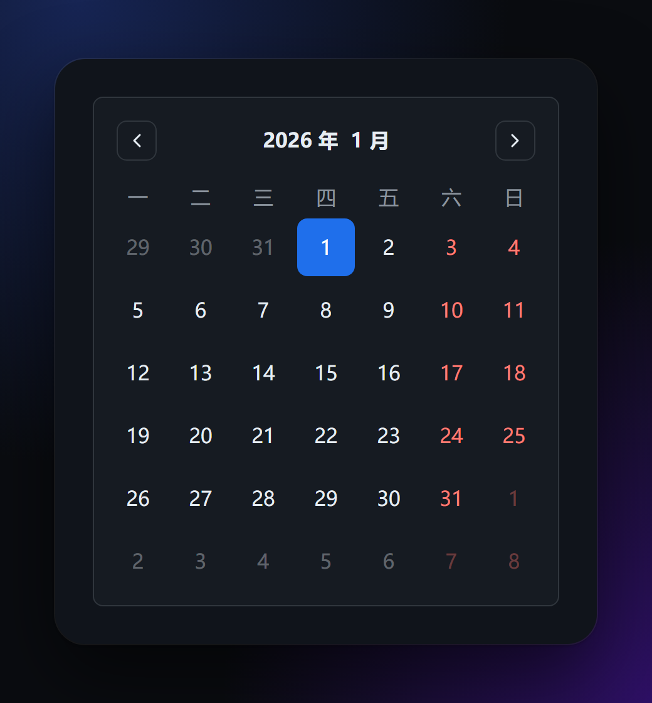
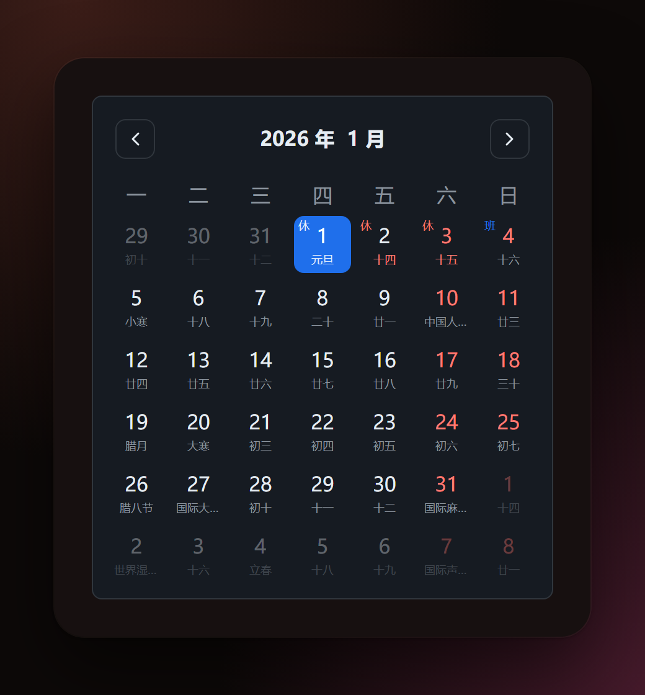

# calendar

公历 / 农历日历工具集：纯 TypeScript 换算核心、零依赖 DOM 日历组件，以及官方农历适配器。

[](https://codecov.io/gh/sanguo-dev/calendar)
[](https://github.com/sanguo-dev/calendar/actions/workflows/coverage.yml)
[](https://github.com/sanguo-dev/calendar/actions/workflows/docs.yml)
[](https://bundlephobia.com/package/@sanguo-dev/calendar-ui)

[](https://sanguo-dev.github.io/calendar/)
[](https://calendardocs.netlify.app/)
[](packages/calendar/LICENSE)
[](package.json)

| calendar-ui                                           | calendar-ui-lunar                                                 |
| ----------------------------------------------------- | ----------------------------------------------------------------- |
|  |  |

## 包概览

| 包                                         | 版本                         | 下载                         | 说明                                    | README                                         |
| ------------------------------------------ | ---------------------------- | ---------------------------- | --------------------------------------- | ---------------------------------------------- |
| [@sanguo-dev/calendar][npm-cal]            | [![npm][v-cal]][npm-cal]     | [![dm][dm-cal]][npm-cal]     | 公历 / 农历换算、节气、干支、节日与调休 | [README](packages/calendar/README.md)          |
| [@sanguo-dev/calendar-ui][npm-ui]          | [![npm][v-ui]][npm-ui]       | [![dm][dm-ui]][npm-ui]       | 纯 DOM、零依赖的公历日历 UI             | [README](packages/calendar-ui/README.md)       |
| [@sanguo-dev/calendar-ui-lunar][npm-lunar] | [![npm][v-lunar]][npm-lunar] | [![dm][dm-lunar]][npm-lunar] | 把农历接入 calendar-ui 的官方适配器     | [README](packages/calendar-ui-lunar/README.md) |

[npm-cal]: https://www.npmjs.com/package/@sanguo-dev/calendar
[npm-ui]: https://www.npmjs.com/package/@sanguo-dev/calendar-ui
[npm-lunar]: https://www.npmjs.com/package/@sanguo-dev/calendar-ui-lunar
[v-cal]: https://img.shields.io/npm/v/@sanguo-dev/calendar.svg?label=%20&color=cb3837
[v-ui]: https://img.shields.io/npm/v/@sanguo-dev/calendar-ui.svg?label=%20&color=cb3837
[v-lunar]: https://img.shields.io/npm/v/@sanguo-dev/calendar-ui-lunar.svg?label=%20&color=cb3837
[dm-cal]: https://img.shields.io/npm/dm/@sanguo-dev/calendar.svg?label=%20
[dm-ui]: https://img.shields.io/npm/dm/@sanguo-dev/calendar-ui.svg?label=%20
[dm-lunar]: https://img.shields.io/npm/dm/@sanguo-dev/calendar-ui-lunar.svg?label=%20

## 特性

- **公历 ⇄ 农历全量互转**：覆盖 1900-01-31（农历庚子年正月初一）~ 2100-12-31，附节气、干支（年 / 月 / 日 / 时）、生肖、星座、星期。
- **节日与调休**：内置 2026、2027 年国务院放假安排；支持按年注入、`replace` 丢弃内置数据、多实例互不影响。**节假日数据需随国务院年度通知更新**。
- **纯 DOM 日历 UI**：零运行时依赖，支持单选 / 范围、双月、折叠、翻月动画，light / dark / auto 主题，周末固定标红。
- **适配器机制**：`CalendarAdapter` 可接任意数据源；官方农历适配器提供节气 / 节日副标题与休 / 班角标，附带农历喜庆红皮肤。
- **TypeScript**：全量类型定义，配置在创建时校验一次、深拷贝并冻结，没有全局可变状态。

## 快速开始

```bash
# npm
npm i @sanguo-dev/calendar

# pnpm
pnpm add @sanguo-dev/calendar

# bun
bun add @sanguo-dev/calendar
```

### 只要日期换算

```ts
import createCalendar from "@sanguo-dev/calendar";

const calendar = createCalendar();
const day = calendar.solarToLunar(2026, 10, 1);

day.lMonthCn; // "八月"（农历月份）
day.lDayCn; // "廿一"（农历日）
day.gljr; // ["国庆节", "国际音乐日", "国际老人节"]（公历节日）
day.xiu; // true（当天是否为休假日，调休补班为 false）
```

### 只要公历日历

```ts
import { createCalendarUI } from "@sanguo-dev/calendar-ui";
import "@sanguo-dev/calendar-ui/style.css";

const ui = createCalendarUI(container, { initialDate: "2026-10-01" });

ui.select("2026-10-08"); // 外部选中
ui.getSelected(); // Date
ui.setMonth(2026, 12); // 翻到 2026 年 12 月
```

### 公历 + 农历 + 节假日

```ts
import { createCalendarLunar } from "@sanguo-dev/calendar-ui-lunar";
import "@sanguo-dev/calendar-ui/style.css";

const ui = createCalendarLunar(container, {
  initialDate: "2026-10-01",
  onSelect: (day) => {
    day.data?.lMonthCn; // 农历月份
    day.data?.nljr; // 农历节日
    day.data?.ban; // true 表示调休补班
  },
});
```

## 数据

- 农历、节气数据覆盖 1900–2100，超出范围会抛 `RangeError`。
- 内置节假日来自国务院办公厅通知：[2026 年](https://www.gov.cn/zhengce/content/202511/content_7047090.htm)、[2027 年](https://www.gov.cn/zhengce/content/202611/content_7085101.htm)。数据过期后可自行替换，见 `replace` 选项。
- 周末固定标红，与节假日数据无关；调休补班由适配器返回的 `data.ban` 标记。

## 文档

完整 API、选项与在线示例，两个站点内容一致：

| 站点         | 地址                                                                    |
| ------------ | ----------------------------------------------------------------------- |
| GitHub Pages | [sanguo-dev.github.io/calendar](https://sanguo-dev.github.io/calendar/) |
| Netlify      | [calendardocs.netlify.app](https://calendardocs.netlify.app/)           |

## 开发

```bash
bun install
vp run dev        # 启动文档站（含示例预览）
vp run ready      # 提交前跑：格式检查 + 全部测试 + 全部构建
vp run -r test    # 只跑全部测试
vp run -r build   # 只构建全部包
```

发布走 changesets + npm Trusted Publishing（OIDC），流程见 [.github/workflows/Release.yml](.github/workflows/Release.yml)。

## License

[MIT](packages/calendar/LICENSE)
